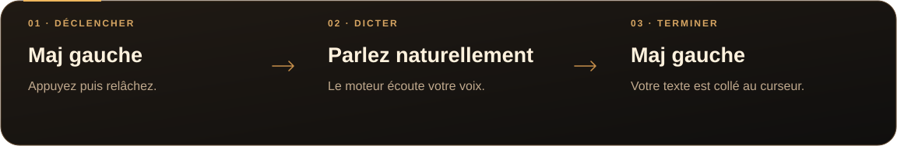
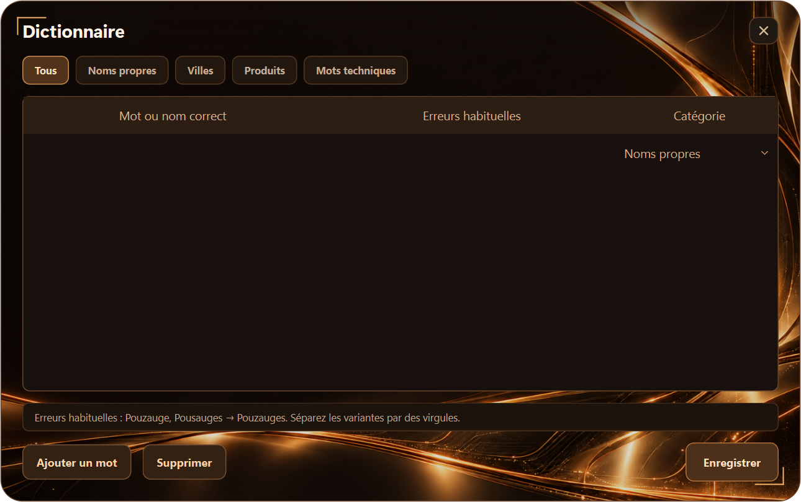
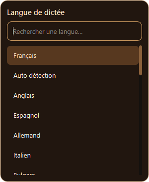

# La parole est votre pouvoir.

**La dictée vocale locale pour Windows, prête à l’emploi.**

Parlez. Retrouvez vos mots dans votre application. Le moteur et les modèles sont déjà inclus.

 

 

[Voir la version 1.1.0](https://github.com/jossmair/Voxcalibur/releases/tag/v1.1.0) · [Guide d’utilisation](docs/UTILISATION.md) · [Nouveautés](docs/RELEASE-1.1.0.md)

---

## Vos idées, directement à l’écran

Placez le curseur là où vous voulez écrire, puis utilisez votre touche de dictée. Voxcalibur transforme votre voix en texte et le colle dans la fenêtre active.

  

Une seule fenêtre. Vos réglages à portée de main. Un petit orbe pour suivre la dictée.

## Un moteur local. Des réglages utiles.

<table>
<tr>
<td width="33%" valign="top">
<h3>Sur votre ordinateur</h3>

Reconnaissance vocale avec <strong>Parakeet Ultra</strong> et détection de parole Silero. Les distributions complètes fonctionnent <strong>hors ligne</strong>.

</td>
<td width="33%" valign="top">
<h3>CPU ou carte graphique</h3>

Activez le GPU compatible <strong>CUDA ou Vulkan</strong>. Le processeur prend le relais si le chargement accéléré échoue.

</td>
<td width="33%" valign="top">
<h3>À votre façon</h3>

Choisissez votre touche, votre langue et vos préférences. <strong>Vos réglages sont conservés</strong> au prochain lancement.

</td>
</tr>
<tr>
<td valign="top">
<h3>Un dictionnaire personnel</h3>

Ajoutez vos noms propres, villes, produits et termes techniques, avec leurs erreurs habituelles à corriger.

</td>
<td valign="top">
<h3>Des nombres bien écrits</h3>

En français, choisissez les <strong>chiffres ou les lettres</strong> et l’abréviation des unités : « 250 grammes » devient « 250 g ».

</td>
<td valign="top">
<h3>Une présence discrète</h3>

Un orbe indique l’activité et donne accès au menu. Le <strong>microphone reste fermé hors dictée</strong>.

</td>
</tr>
</table>

## Trois gestes pour écrire

**Maj gauche est la touche par défaut.** Vous pouvez la remplacer dans les préférences. Le texte est aussi disponible dans le presse-papiers et le menu permet de récupérer le texte conservé.

## Choisissez votre version

| | **Installable** | **Portable** |
| :-- | :-- | :-- |
| Pour quel usage ? | Installer Voxcalibur sur votre PC | Le lancer depuis un dossier décompressé |
| Premier lancement | `Installer-Voxcalibur.exe` | `Voxcalibur.exe` |
| Moteur et modèles | Inclus | Inclus |
| Suite Ergonatus requise | Non | Non |
| Taille de l’archive | 1,89 Go | 1,87 Go |
| Téléchargement | [**Version installable**](https://github.com/jossmair/Voxcalibur/releases/download/v1.1.0/Voxcalibur-1.1.0-Installation.zip) | [**Version portable**](https://github.com/jossmair/Voxcalibur/releases/download/v1.1.0/Voxcalibur-1.1.0-Portable.zip) |

**Décompressez entièrement l’archive avant de lancer le logiciel.** Pour l’installation, gardez les quatre fichiers ensemble. Pour la version portable, conservez les dossiers `_internal`, `models` et `runtimes` avec l’exécutable. Les préférences restent dans votre profil Windows dans les deux éditions.

**Configuration :** Windows 10/11 x64, microphone autorisé dans Windows ; 16 Go de RAM conseillés. Python n’est pas nécessaire pour les versions compilées.

<strong>Voir le dictionnaire et les langues</strong>

### Votre vocabulaire, au même endroit

### Une langue facile à retrouver

La palette de langues propose une recherche et une navigation au clavier. Parakeet Ultra détecte la langue à partir de l’audio : le sélecteur ne force pas son décodeur. Les corrections françaises sont appliquées lorsque **Français** est sélectionné.

[Consulter le guide détaillé](docs/UTILISATION.md)

## Une version vérifiée

Ces contrôles portent sur la **version 1.1.0**. La précision dépend de la voix, du bruit ambiant et des mots prononcés. Les essais de transcription réels ont été effectués sur CPU et CUDA ; Vulkan est inclus et sélectionné sur les configurations compatibles.

[Rapports de validation](docs/validation/release.json) · [Empreintes SHA-256](https://github.com/jossmair/Voxcalibur/releases/download/v1.1.0/SHA256SUMS.txt) · [Historique des versions](https://github.com/jossmair/Voxcalibur/releases)

## Documentation et code

| Pour… | Ouvrir… |
| :-- | :-- |
| Installer, dicter et régler Voxcalibur | [Le guide d’utilisation](docs/UTILISATION.md) |
| Découvrir les changements de la 1.1.0 | [Les notes de version](docs/RELEASE-1.1.0.md) |
| Comprendre l’application indépendante | [L’architecture](docs/ARCHITECTURE.md) |
| Développer ou compiler | [Le guide de développement](docs/DEVELOPPEMENT.md) |
| Signaler un problème ou proposer une idée | [Les tickets GitHub](https://github.com/jossmair/Voxcalibur/issues) |

Voxcalibur est issu de Transcrinator et reprend les ajouts de sa version intégrée à Ergonatus. Il possède son propre moteur embarqué, ses dossiers, ses raccourcis et ses réglages.

### Licences

Le **code est sous licence [MIT](LICENSE)**. Parakeet Ultra : Moondream/NVIDIA, CC BY 4.0 ; conversion GGUF Q8 par mudler. Silero VAD : MIT. Les licences des modèles et runtimes, dont CUDA, sont incluses dans les distributions ; elles sont distinctes de celle du code.

---

**Voxcalibur** · Dictée locale pour Windows 
[Installer](https://github.com/jossmair/Voxcalibur/releases/download/v1.1.0/Voxcalibur-1.1.0-Installation.zip) · [Utiliser sans installation](https://github.com/jossmair/Voxcalibur/releases/download/v1.1.0/Voxcalibur-1.1.0-Portable.zip) · [Voir le code](https://github.com/jossmair/Voxcalibur)

