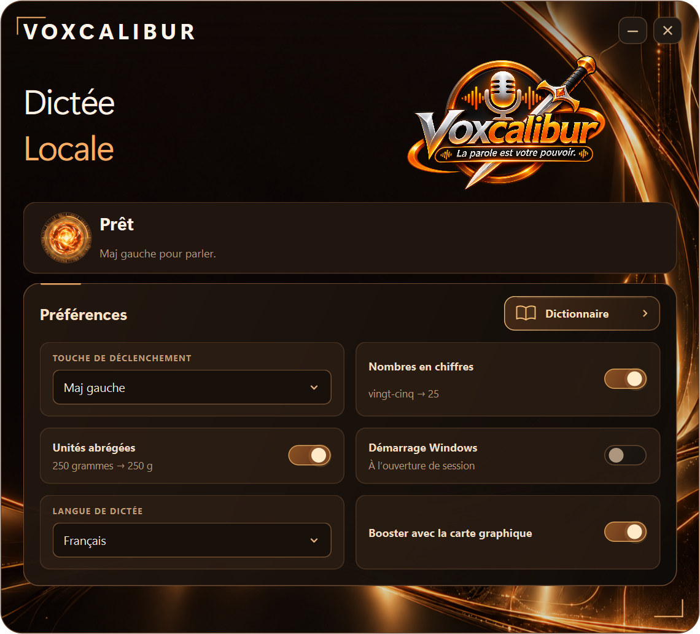

# Voxcalibur 1.0.0

**La parole est votre pouvoir.** Dictée vocale locale pour Windows 10/11 x64, issue de Transcrinator 1.3.17.

Application indépendante, sans lanceur ni service Ergonatus. Les versions complètes incluent Parakeet Ultra, Silero VAD et les runtimes CPU, Vulkan et CUDA. Aucun compte, clé API ou téléchargement au premier lancement.

## Portable

Décompressez entièrement `Voxcalibur-1.0.0-Portable.zip`, puis lancez `Voxcalibur.exe`. Gardez `_internal`, `models` et `runtimes` avec l'exécutable. Aucun démarrage Windows n'est ajouté par le simple lancement portable.

## Installation

Décompressez `Voxcalibur-1.0.0-Installation.zip` et lancez `Installer-Voxcalibur.exe`. Conservez `payload.zip`, `payload.json` et `uninstaller.exe` à côté. Installation par utilisateur sans administrateur ; désinstallation depuis les applications Windows.

## Utilisation

Placez le curseur dans votre application. Appuyez puis relâchez **Maj gauche**, parlez, puis appuyez de nouveau pour terminer. Le texte complet est copié et collé dans le focus Windows courant. Le menu près de l'horloge permet d'ouvrir Voxcalibur, de récupérer le texte conservé et de quitter. Le microphone reste fermé hors dictée.

Préférences : touche, nombres en chiffres, unités abrégées, démarrage Windows et dictionnaire personnel. Accélération compatible automatique, avec repli CPU.

Dossiers propres : `%LOCALAPPDATA%/Voxcalibur` et `%LOCALAPPDATA%/Programs/Voxcalibur`. Raccourci, verrou et entrées Windows indépendants. Le profil Transcrinator et la suite sont préservés. La version portable conserve également ses préférences dans le profil utilisateur.

## Développement

Python 3.11+, dépendances dans `requirements-lock.txt`. `scripts/build.ps1` lance les tests, compile, vérifie et ajoute les modèles et runtimes, puis produit les distributions. Les modèles réels et runtimes doivent être disponibles via `VOXCALIBUR_BUNDLE` avant compilation. `VOXCALIBUR_DATA` isole le profil de développement.

```powershell
python -m venv .venv
.venv/Scripts/python.exe -m pip install -r requirements-lock.txt
.venv/Scripts/python.exe -m pytest -q
./scripts/build.ps1
```

Le code moteur et son intégration sont dans `app/engines`. Poids et binaires natifs volumineux sont distribués en archives hors historique Git. `bundle.json` référence les modèles et leurs empreintes ; `SHA256SUMS.txt` permet de vérifier les archives.

## Identité et licences

Logo fourni, conservé dans `assets/voxcalibur-logo.png`. Icône Windows obtenue par redimensionnement proportionnel. Interface sombre, ambre et argent avec animations audio locales.

Code MIT, dérivé de Transcrinator. Parakeet Ultra : Moondream/NVIDIA, CC BY 4.0 ; conversion GGUF Q8 par mudler. Silero VAD : MIT. Licences des modèles et runtimes, dont CUDA, incluses. Les symboles ABI historiques `transcrinator_*` sont conservés pour la compatibilité du moteur natif.

## Validation de cette version

258 tests automatisés réussis. Transcription réelle vérifiée depuis l'exécutable sur CPU et CUDA ; installation et désinstallation complètes vérifiées dans un profil isolé. Rapports dans `docs/validation`.



## Publication GitHub

Le dépôt local est prêt. Une fois GitHub CLI installé et connecté avec `gh auth login`, exécuter `./scripts/publish_github.ps1`. Ce script crée un nouveau dépôt privé `jossmair/Voxcalibur`, publie les sources puis les trois archives et les empreintes dans la version `v1.0.0`. Il refuse de publier si ce nom de dépôt existe déjà.
